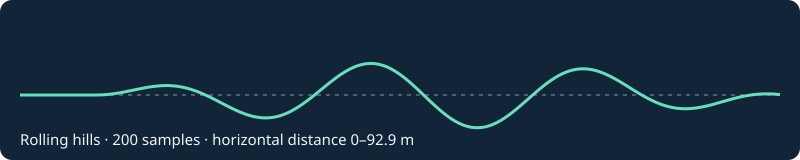

# Bipedal Terrain Studio｜地形を描いて二足歩行AIを比較する

手描きの地形で二足歩行ロボットの制御器を比較するため、地形変換・保存機構と評価方法を制作しました。GymnasiumとBox2Dを使用する構想のうち、このリポジトリでは地形を扱うPythonコードと開発記録を公開しています。ブラウザアプリ、学習済みモデル、歩行リプレイの実装は含めていません。

これは[サンプル地形](examples/rolling_hills.heightfield.json)から描いた断面図です。左端の平坦な区間でロボットの初期姿勢を揃え、その先の起伏を変えられるデータ形式にしています。

## 制作したもの

- **地形の変換**　左から右へ描いた線を200点の高さに変換します。高さの飛びや開始地点の段差を検出し、同じ地形を再現できるようにします。
- **地形ライブラリ**　地形をJSONで保存し、読み戻すときにSHA-256で整合を確認します。保存ファイル名には自動生成したIDを使用します。
- **比較評価の設計と記録**　同じ地形・初期条件で制御器を比較する方法を整理しました。高難度地形の開発評価では、一方の制御器が平均で長く動いても、報酬の差は小さい結果でした。[200エピソードの比較](docs/development-results.md)にまとめています。

## コード検証

モデルなしで試せる[地形変換](src/robust_bipedal/terrain_geometry.py)と[保存処理](studio/user_library.py)、[テスト](tests)を収録しています。実行方法は[地形データの保存と再現](docs/studio.md)をご覧ください。

[初期設計](docs/MASTER_PLAN_v2.md)と[評価方法の設計記録](docs/EVALUATION_PROTOCOL.md)は、開発時点の計画を確認するための資料です。現時点でブラウザ上のシミュレーションや制御器学習をこのリポジトリだけで再現できるという意味ではありません。
